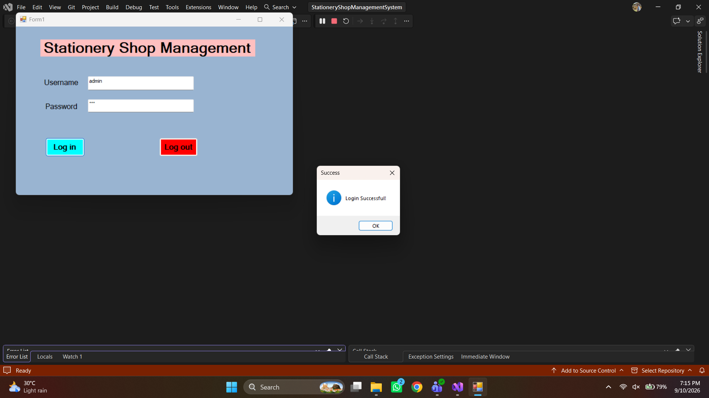
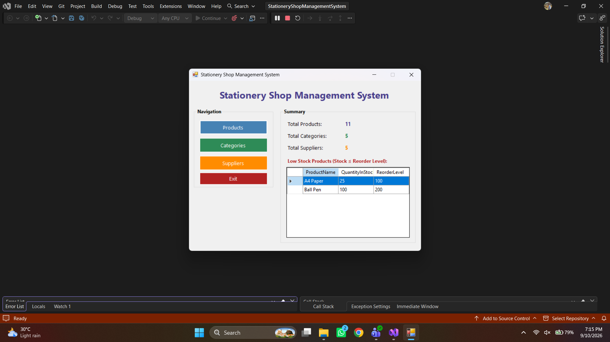
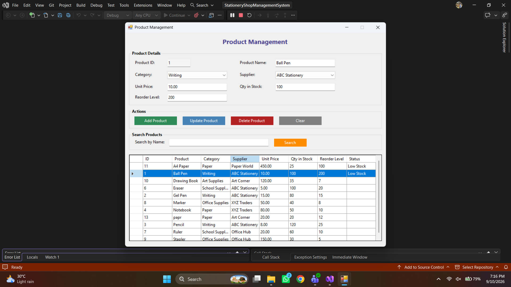
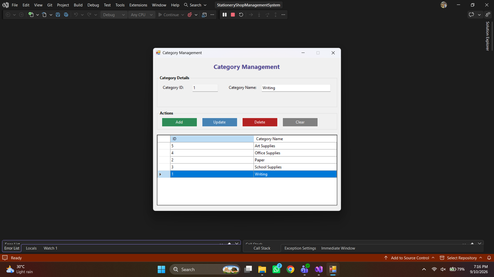
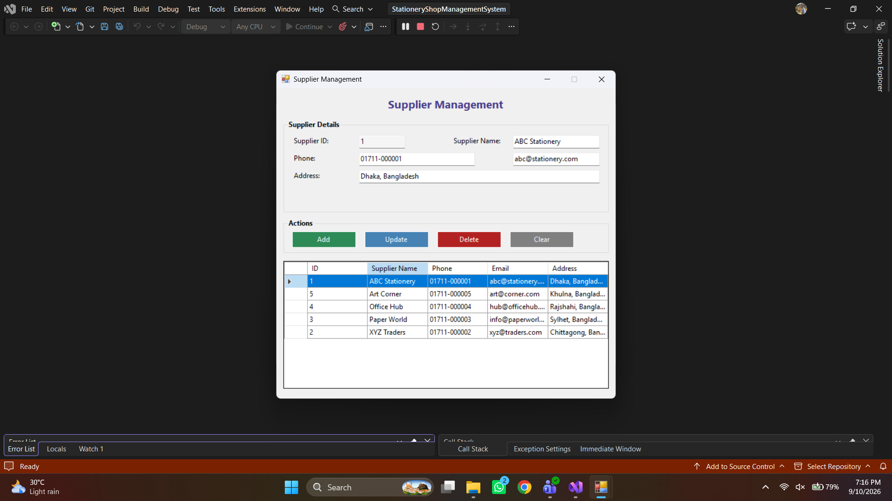
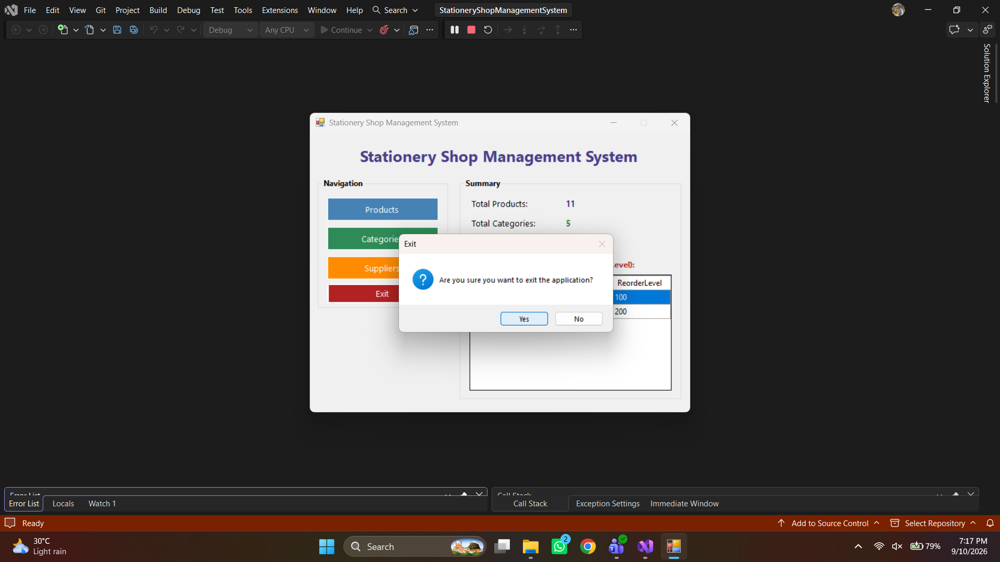

# 📚 Stationery Shop Management System

A desktop-based management application developed in **C# Windows Forms** with **Microsoft SQL Server (MSSQL)** to streamline inventory operations, product tracking, supplier management, and low-stock monitoring for retail stationery businesses.

---

## 📌 Project Overview

The **Stationery Shop Management System** is designed to replace manual record-keeping with an automated desktop solution. It provides an intuitive interface for managing products, tracking stock levels in real time, alerting users when items reach their reorder points, and maintaining detailed supplier and category directories.

Developed as the **Final Term Project** for:
* **Course**: CSC 2210: Object Oriented Programming 2 (OOP2)
* **Institution**: American International University-Bangladesh (AIUB)
* **Semester**: Summer 2025-2026 | **Section**: S | **Group**: 7
* **Supervised By**: Md. Sadik Tasrif Anubhove

---

## ✨ Key Features

- 🔐 **Authentication System**: Secure administrative login portal (`admin` / `123`).
- 📊 **Executive Dashboard**:
  - Live statistics: Total Products, Active Categories, and Registered Suppliers.
  - Quick-view table flagging low-stock items requiring replenishment.
- 📦 **Product Management**: Full CRUD operations (Add, Edit, Delete, View) with unit pricing, stock quantity, category association, and supplier linkage.
- 🏷️ **Category Management**: Organize inventory items into clear categories with quick search capabilities.
- 🚚 **Supplier Directory**: Maintain complete vendor profiles including contact person, phone number, email, and physical address.
- ⚠️ **Automated Low-Stock Alerts**: Dynamic queries that flag products where `QuantityInStock <= ReorderLevel`.

---

## 🛠️ Technology Stack

| Component | Technology |
| :--- | :--- |
| **Programming Language** | C# |
| **Framework** | .NET Framework 4.8 (Windows Forms) |
| **Database** | Microsoft SQL Server (MSSQL) |
| **Data Access** | ADO.NET (`System.Data.SqlClient`) |
| **IDE** | Visual Studio 2019 / 2022 |

---

## 📸 Screenshots

| 1. Login Screen | 2. Main Dashboard & Low-Stock Alerts |
| :---: | :---: |
|  |  |

| 3. Product Management | 4. Category Management |
| :---: | :---: |
|  |  |

| 5. Supplier Management | 6. Exit |
| :---: | :---: |
|  |  |

---

## 🚀 Setup & Installation

### 1. Database Setup
1. Launch **SQL Server Management Studio (SSMS)**.
2. Open the script located at:
   ```
   StationeryShopManagementSystem/Database/StationeryShopDB.sql
   ```
3. Execute the script (`F5`) to create the `StationeryShopDB` database and pre-populate sample tables and seed data.
4. Verify your SQL Server connection string in:
   `StationeryShopManagementSystem/Helpers/DatabaseHelper.cs`
   ```csharp
   private static string connectionString =
       @"Data Source=.;Initial Catalog=StationeryShopDB;Integrated Security=True";
   ```
   *(Update `Data Source` if your local SQL Server instance uses a named instance like `.\SQLEXPRESS`).*

### 2. Building & Running the Project
1. Open `StationeryShopManagementSystem.slnx` or `StationeryShopManagementSystem/StationeryShopManagementSystem.csproj` in **Visual Studio**.
2. Select **Debug** configuration and **Any CPU** platform.
3. Build the solution (`Ctrl + Shift + B`).
4. Press **F5** or click **Start** to run the application.

### 3. Default Admin Credentials
* **Username**: `admin`
* **Password**: `123`

---

## 📁 Repository Structure

```
├── Database/
│   └── StationeryShopDB.sql            # Complete DB schema and sample seed data
├── Forms/
│   ├── Form1.cs                        # Login authentication form
│   ├── MainForm.cs                     # Dashboard with live KPI counters
│   ├── ProductForm.cs                  # Product inventory management
│   ├── CategoryForm.cs                 # Category classification
│   └── SupplierForm.cs                 # Supplier contact directory
├── Helpers/
│   └── DatabaseHelper.cs               # Centralized SQL Server connection handler
├── Models/
│   ├── Product.cs                      # Product domain model
│   ├── Category.cs                     # Category domain model
│   └── Supplier.cs                     # Supplier domain model
├── Screenshots/                        # Application preview images
├── Report_Group 7_S_24-58475-2.pdf     # Official Project Documentation
└── Screen video of working project.mp4 # Video demonstration
```

---

## 👥 Project Team (Group 7)

| Name | Student ID |
| :--- | :--- |
| **Tousif Bin Mostofa** | 24-58475-2 |
| **Hasnine Alom Rimon** | 24-57079-1 |
| **Diba Biswas** | 24-60003-3 |
| **Jannatul Ferdous Mim** | 24-59940-3 |
| **Kazi Simi Ashnah** | 24-58688-2 |

---

## 📄 License & Academic Note
This project was created for educational purposes as part of the **Object Oriented Programming 2 (OOP2)** curriculum at **AIUB**.
